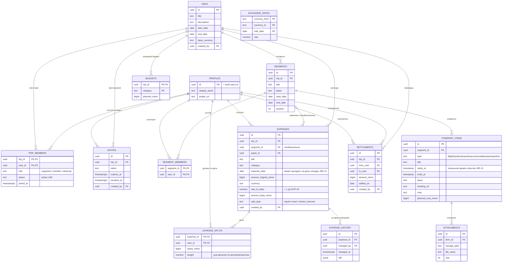

# ER-диаграмма базы данных

Соответствует разделу 8 ТЗ («Логическая модель данных»). Все суммы — `bigint` в минимальных единицах валюты (BR-01). Курсивом отмечены поля, которые заполняются только после реализации соответствующих требований (например, `currency`/`rate_to_base` в `expenses` — до EXP-10 всегда базовая валюта и курс 1).

## Примечания к схеме

- **BR-04 (инвариант расхода)** — сумма `expense_splits.share_minor` по `expense_id` должна строго равняться `expenses.amount_base_minor`. Проверяется в Postgres-функциях `create_expense`/`update_expense`, а не на уровне схемы (агрегатный CHECK по строкам в Postgres не выразить напрямую).
- **BR-08** — `trips.base_currency` неизменна после первого `expenses` по этой поездке; проверяется в RPC `update_trip`, а не constraint'ом.
- **BR-11** — `expense_splits` не зависит от текущего состава `segment_members`: доли фиксируются на момент создания расхода и не пересчитываются при изменении сегмента.
- `SEGMENTS o|--o{ EXPENSES` — связь необязательная: `expenses.segment_id` может быть `NULL` (расход без привязки к сегменту).
- `EXCHANGE_RATES` не привязана к конкретной поездке — общий кэш курсов на дату, используется при создании расхода (EXP-10, BR-07) и не связана внешними ключами с остальными таблицами.
- Проверка членства в RLS-политиках всех таблиц выполняется через `security definer`-функции `is_trip_member(trip_id)` / `trip_role(trip_id)`, а не прямым JOIN на `trip_members` (см. CLAUDE.md) — на диаграмме это не отображено, так как относится к политикам, а не к структуре таблиц.
